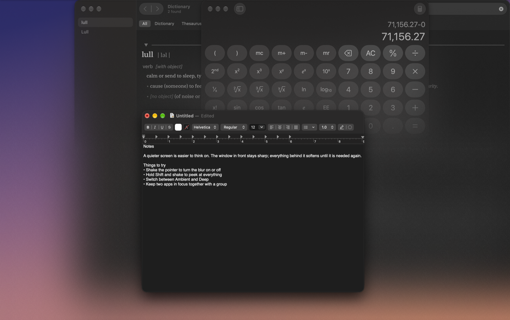
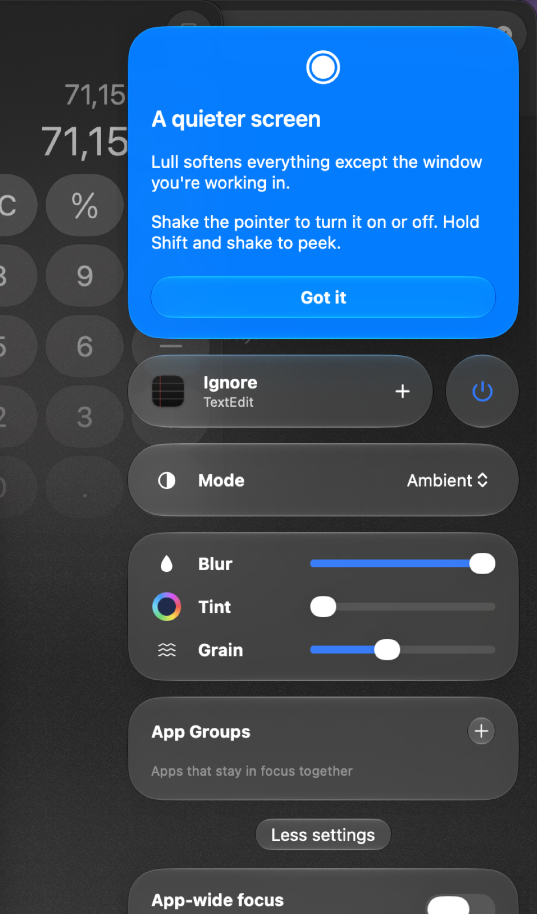

# Lull

Lull blurs everything on your Mac's screen except the window you are working in. It sits in the menu bar and follows the window in front as you switch.



Lull needs macOS 26 or later. It is free and open source.

## Install

1. Download the DMG from the [latest release](https://github.com/dlev02/Lull/releases/latest).
2. Drag Lull to Applications.
3. Open it.

Lull has no Dock icon. It shows a circle in the menu bar, and the panel opens by itself the first time.

Lull starts at login and checks for updates once a day; an update installs the next time Lull quits. Both can be turned off under **More settings** in the panel.

## Use

### The panel

Click the menu bar icon to open the panel. Click outside it or press Escape to close it. Right-click the icon for a short menu with Quit.



| Setting | What it does |
| --- | --- |
| Mode | **Ambient** keeps the top of the screen clear and fades to full blur about halfway down. **Deep** blurs everything. |
| Blur, Tint, Grain | Sliders for the look. The swatch beside Tint sets its colour. |
| App Groups | Apps that stay sharp together: when one is in front, every window of each app in the group is sharp. |
| App-wide focus | Keeps every window of the app in front sharp, not only the front one. |
| Multi-screen mode | **Global** keeps one focus across all displays. **Per screen** keeps the front window on each display sharp. |
| Auto-hide | Hides the Dock, the menu bar or both while Lull is focusing, and puts them back afterwards. |
| Blur Stage Manager | Stage Manager's thumbnails stay sharp unless this is on. |
| Menu bar icon | A click opens the panel or toggles Lull, or the icon is hidden. When it is hidden, open Lull again from Finder or Spotlight to get the panel. |
| Monochrome | Drains the colour from everything that is blurred. |
| Transition | How long the blur takes to arrive and leave. |
| Reveal effect | **Fade** fades the blur in. **Focus** pulls it up from nothing, like a lens. **Pointer** spreads it outward from the pointer. |
| Ignored apps | Lull stands down while one of these apps is in front. Finder is ignored by default. |

The button at the top of the panel adds the app in front to the ignored apps, or removes it.

### Gestures

- Shake the pointer from side to side to turn Lull on or off.
- Hold Shift and shake to peek: everything is sharp until you let go of Shift.
- **Peek at corners** is off by default. When it is on, everything is sharp while the pointer rests in a corner of the screen.

The modifier keys and the shake sensitivity are under **Gestures** in the panel.

### Shortcuts

| Action | Default |
| --- | --- |
| Toggle Lull | Control-Option-Command-F |
| Switch Mode | Control-Option-Command-M |
| Ignore App (the app in front) | Control-Option-Command-E |
| Toggle Controls (the panel) | Control-Option-Command-C |

Change or remove a shortcut under **Shortcuts** in the panel.

## Command line

The `lull` command is the app's own executable, so there is nothing else to install. In the panel, open **More settings**, expand **Scripting Commands** and click **Install lull Command**. This links `/usr/local/bin/lull` to the app, and asks for an administrator password only if that folder is not writable.

Commands reply in JSON and exit with 0 on success and 1 on failure. If Lull is not running, the command starts it.

| Command | What it does |
| --- | --- |
| `lull toggle` | Turn Lull on or off. Also `lull on` and `lull off`. |
| `lull status` | The current state and every setting. |
| `lull mode deep` | Switch mode: `ambient`, `deep` or `toggle`. |
| `lull blur 60` | Set a slider from 0 to 100. Also `tint`, `grain` and `transition`. |
| `lull ignore add Mail` | Ignore an app, by name or bundle identifier. Also `remove`, `toggle` and `list`. |
| `lull group add Mail Notes` | Keep two or more apps sharp together. |
| `lull peek on` | Show everything until `lull peek off`. |
| `lull diagnostics` | Version, displays, settings and the recent log, for a bug report. |

Run `lull help` for the rest.

`lull://` links run the same commands, with the path as the command: `open lull://toggle`, `open lull://mode/deep`, `open lull://blur/60`. Links can't reset settings, quit Lull, install updates, or change start at login or Auto-hide.

## How it works

Lull places one click-through window per display directly beneath the focused window. That window asks the system to blur whatever is behind it, so macOS does the blurring. Lull never captures the screen and draws no frames. Between focus changes it does no work, apart from watching pointer movement for the gestures while they are on.

A second window per display sits behind every app window. It is shown only when Stage Manager's strip is on screen, to blur the wallpaper around the thumbnails.

Lull uses private macOS interfaces for two things: the adjustable blur, and notifications from the window server when windows open, close or change order. Each one is looked up at run time. If a macOS update removes one, Lull falls back to a public interface: a fixed-strength system blur with no soft fade, and following focus through app switches and clicks. `lull diagnostics` reports which blur is in use.

## Privacy

- The only network connection is the update check: the feed comes from `raw.githubusercontent.com` and the download from `github.com`.
- There is no analytics, no crash reporting and no account. Settings stay in the app's preferences on your Mac.
- Lull needs no permissions for normal use. Only Auto-hide asks for Automation, and only when you turn it on.

Details are in [PRIVACY.md](PRIVACY.md).

## Build from source

Open the project in Bitrig, or build it from the command line:

```sh
xcodebuild -project Lull.xcodeproj -scheme Lull build
```

Sparkle is the only dependency, and Swift Package Manager fetches it. Only one copy of Lull runs at a time, so quit the installed copy before opening the one you built. A copy run from outside an Applications folder does not check for updates or add itself to the login items.

See [CONTRIBUTING.md](CONTRIBUTING.md) for how to try a change.

## Licence

Lull is licensed under the [GNU General Public License, version 3](LICENSE). Copyright 2026 Drew Levinson. See [NOTICE](NOTICE) for third-party acknowledgements.
